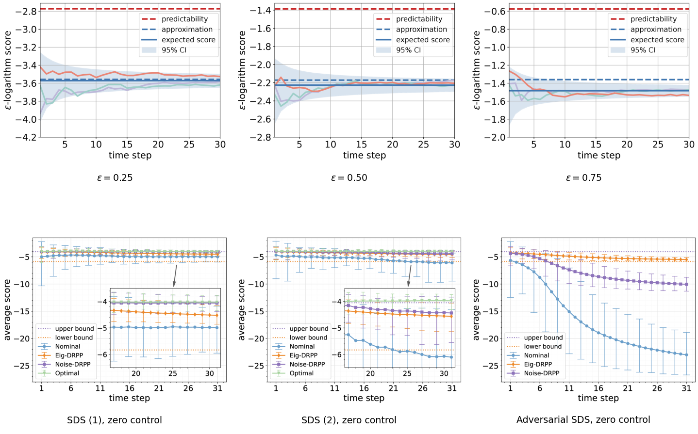

# The ceiling

> **How well could anything predict this system? The ceiling, and the figure from the paper.**

| | |
|---|---|
| **Who it is for** | You want to reproduce or check the paper's figure, or you want to know what “good” means before measuring anything |
| **Prerequisites** | The idea of a scoring rule. No paper required — the golden values are printed |
| **Runs on** | `pip install ppsds` alone |

## Six numbers you can check by hand

```bash
python examples/understand_predictability/quickstart.py     # about two seconds
```

The system is a shear `x_{k+1} = A x_k + w_k` with uniform noise, `T = 30`. The script prints the
noise's differential entropy and the cross-entropy against the predictor, then compares three
quantities at three radii:

```
Reference values, from the laws (not from samples):
  differential entropy of the noise   h_d(q)    = +1.38629
  cross-entropy against the predictor H(q || p) = +2.17123

eps    predictability approximation     measured      |err|  |err|/eps
----------------------------------------------------------------------------
0.25       -2.77259     -3.55752     -3.57173    0.01421    0.05683
0.5        -1.38629     -2.17123     -2.22676    0.05553    0.11107
0.75       -0.57536     -1.36030     -1.48379    0.12349    0.16466
```

**What to conclude:** the `predictability` column is a property of the **system**, not of any
predictor: no predictor is involved in computing it, and nothing can beat it. The `approximation`
column is where the paper says *this* predictor should land, up to an error of order `epsilon`. The
`measured` column tracks it, and the error grows with `epsilon` exactly as the paper reports.

Two things reviewers ask about, both visible here:

- **The gap between the two lines is the price of misspecification**, not evidence of a bad
  implementation. The predictor is a diagonal Gaussian; the true noise is uniform.
- **The two lines do not meet at `epsilon = 0`.** The score is discontinuous there: at exactly
  `epsilon = 0` it is `log p(x)`, while for any `epsilon > 0` it carries a `d_x * log(2 epsilon)`
  volume term. Neither line is a limit of the other.

## The paper's figure, at the paper's scale

The [predictability experiment](../../experiments/predictability.md) runs the same system over
100,000 trajectories and writes the three-panel figure, at the resolution the paper uses. It takes
seconds rather than minutes — the whole point of this side of the package is that it is **cheap**,
because it never solves an optimization problem.



## Next

- **The derivation and the evaluation recipe**: [the predictability paper](../../research/probabilistic-predictability.md)
- **The same thing at paper scale**: [the predictability experiment](../../experiments/predictability.md)
- **The other side of the question**: [what “worst case” means](../understand_drpp_on_simulated_ambiguity/index.md)
- **Put a predictor on your own system**: [Getting Started](../../tutorials/getting-started.md)
