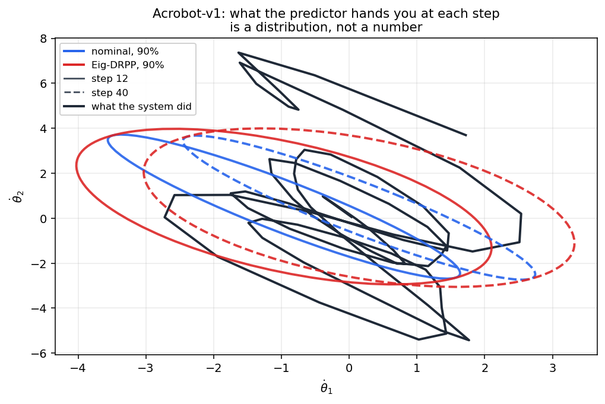
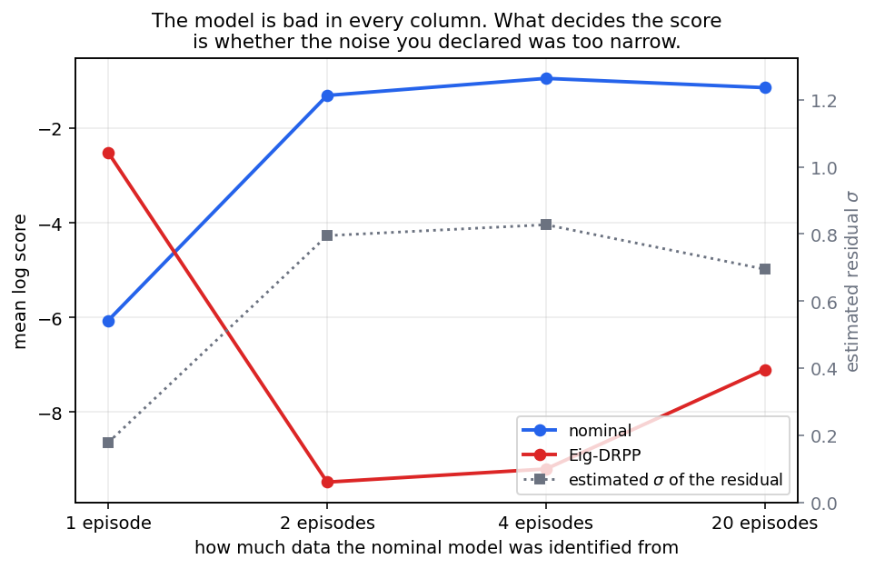

# Getting Started

This page takes you from a fresh install to a predictor running on **your own** gymnasium
environment. This release ships one DRPP, the one for **conic-moment** ambiguity sets, and that
is the predictor used here. The path is short (you declare three things and run a loop), but one
precondition is worth stating before anything else.

> **The guarantee has a precondition: the ambiguity set you declare must contain the true
> system.** `ppsds` is not "install it and the predictions get better". It is "state what you are
> uncertain about, and get a **worst-case lower bound** on the score". Declare too little and the
> bound is vacuous; declare too much and the predictions are needlessly conservative. Choosing
> those declarations is the whole job; see [Concepts](concepts.md) for what the predictors
> actually optimize.

## Install

```bash
pip install ppsds
```

To run the examples in this repository, install from a checkout instead, so the editable `ppsds`
resolves to the tree you are reading:

```bash
git clone https://github.com/Xuzerken/ppsds
cd ppsds
pip install -e ".[experiments]"     # `experiments` adds matplotlib/pandas/seaborn/tqdm for the figures
```

The core needs only `numpy`, `scipy`, `cvxpy` and `gymnasium`, and Python 3.10 or newer. The
[README](https://github.com/Xuzerken/ppsds/blob/main/README.md#install) has the full dependency
split; the short version is that the predictors and `ppsds.environment` are core, while
`ppsds.experiment` and `ppsds.visualization` sit behind the optional `experiments` extra.

## The smallest thing that runs

```bash
python examples/apply_drpp_to_your_own_env/quickstart.py
```

About one second, 50 steps, on a two-state system that stands in for "your own environment":

```
Running 50 steps on **one ordinary trajectory** (your own environment, zero control)

predictor     mean log score   note
----------------------------------------------------------------
nominal               -2.867   trusts the nominal model
Eig-DRPP              -3.366   made robust to the worst case
```

Read the two numbers **as a pair**. `nominal` scores higher here, and that is the normal case, not
a bug; see the first pitfall below. The real content of the example is the shape of the
workflow: the environment is only ever stepped, the predictors take their model from an ambiguity
set you declared, and each score is computed against the state that actually arrived.

## Putting it on your own environment (scene 1)

Section 0 of
[`quickstart.py`](https://github.com/Xuzerken/ppsds/blob/main/examples/apply_drpp_to_your_own_env/quickstart.py)
is a stand-in environment; everything after it is what you actually write. **You do not modify
the environment.** You declare three things, and the order matters:

```python
import numpy as np
from ppsds.ambiguity.additive_drift.conic_moment import LinearAmbiguitySet
from ppsds.probabilistic_predictor.drpp.additive_drift.conic_moment import (
    NominalPredictor, EigDrpp,
)
from ppsds.scoring_rule.logarithm_score import LogarithmScore

# (1) The nominal model -- "what I believe my system is".
#     Independent of which family you pick: changing family does not touch this.
A_bar = np.array([[1.0, 0.10], [0.0, 1.0]])
B_bar = np.array([[1.0], [0.0]])
mu_bar = np.zeros(2)
Sigma_bar = np.array([[1.0, 0.45], [0.45, 1.30]])

# (2) Fix the **family** of the ambiguity set first. Different families describe uncertainty
#     in completely different languages, so this decides what step (3) has to supply.

# (3) Within that family, declare its parameterization.
alphas = {'A': 0.30, 'B': 0.30, 'mu': 0.25, 'Sigma': 3.0}
f_err_max = 0.30
abg = LinearAmbiguitySet(A_bar, B_bar, mu_bar, Sigma_bar, alphas, f_err_max)

# (4) The predictors take their model from the ambiguity set -- do not retype the literals,
#     or "the model the predictor uses" and "the model the set declares" drift apart.
predictors = {
    'nominal':  NominalPredictor(abg.f_bar, abg.mu_bar, abg.Sigma_bar),
    'Eig-DRPP': EigDrpp(abg.f_bar, abg.mu_bar, abg.Sigma_bar, abg.gamma),
}
scorer = LogarithmScore()

x, _ = env.reset(seed=0)                     # `env` is yours; DRPP never needs to modify it
for _ in range(50):
    u = policy(x)
    for pred in predictors.values():
        pred.update(x, u)                    # update from the current observation
    x, *_ = env.step(u)
    for name, pred in predictors.items():
        score = scorer.score(pred.predict(), x)
```

The one line that is easy to get wrong is the timing: the predictors are updated from `(x, u)`
**before** `env.step(u)`, and the prediction just issued is scored against the state that comes
back. `ppsds` never asks the environment for anything, so nothing about your environment has to
change to fit it.



## What DRPP is worth depends on what you declared

Before you commit to the robust predictor, look at what it actually buys. The figure below is the
same off-the-shelf environment (`Acrobot-v1`) scored with a nominal model identified from
different amounts of data. The model is bad in every column — that never changes. What changes is
whether the noise you declared was **too narrow**:



- With **one episode** the residual is badly underestimated, `Sigma_bar` comes out far too narrow,
  and the nominal predictor scores terribly on the errors it meets — while the robust one holds.
- With **more data** the estimate is calibrated, the nominal predictor wins, and DRPP's robustness
  is pure insurance premium.

So the decision is not "how good is my model" but **"how confident am I in my own declaration"** —
and too little identification data is the most common source of misplaced confidence. The
[`apply_drpp_to_your_own_env`](https://github.com/Xuzerken/ppsds/tree/main/examples/apply_drpp_to_your_own_env)
story runs the whole comparison and prints the table these two figures are drawn from.

### If you do not know a nominal model

If your environment has no analytic dynamics, identify a linear model from rollouts first:

```python
from ppsds.dynamics.identification import collect_rollouts, fit_linear, diagnose, format_report

X, U, X_next = collect_rollouts(env, policy, n_episodes=20, T=200)
fit = fit_linear(X, U, X_next)          # x' ~= A x + B u + c
res = fit.residuals(X, U, X_next)
print(format_report(diagnose(res, X_next - X), fit))
```

That report tells you how large the residual is, whether it still has lag-1 structure, and
whether its covariance is numerically singular: the numbers your declarations should be based
on. The [Acrobot](https://github.com/Xuzerken/ppsds/blob/main/examples/apply_drpp_to_your_own_env/with_standard_gym_env.py)
and [Pendulum](https://github.com/Xuzerken/ppsds/blob/main/examples/apply_drpp_to_your_own_env/pendulum_singular_covariance.py)
examples do exactly this, and their output is on the [Examples](examples.md) page.

## Common pitfalls

**1. On an ordinary trajectory, DRPP scores *lower* than nominal, and that is expected.** The
example above shows it. DRPP trades average performance for a worst-case floor; on a trajectory
where your declaration happens to be about right, the conservatism is pure cost. What makes DRPP
win is not a bad model but an **optimistic declaration** (pitfall 4).

**2. The conic-moment radii mix squared and un-squared quantities.** This is the easiest place to
be off by a square:

```
f_err_max            un-squared:  ||true drift - f_bar(x, u)|| <= f_err_max
alphas['mu']         squared:     |true mean - mu_bar| <= sqrt(alphas['mu'])
alphas['Sigma']      scaling:     true covariance is dominated by alphas['Sigma'] * Sigma_bar
alphas['A'], ['B']   un-squared:  largest perturbation of the corresponding A / B entry
```

`f_err(x, u)` (also exposed as `gamma[0]`) is the odd one out: the callable returns a **squared**
bound, while `f_err_max` is the un-squared hard bound. Their magnitudes set the magnitude of the
score, so they are not numbers to guess: take them from physics (unobserved perturbations,
actuator and sensor noise, unmodelled high-frequency dynamics), or from a first run whose
magnitude you check against your intuition for "how accurate the prediction should be".

**3. A deterministic environment has no noise to measure, and its residual covariance is often
structurally singular.** Most classic gymnasium environments return bit-identical results for the
same state and action. That is not a defect: the model is a statement about what you believe, and
a deterministic environment simply means the noise is entirely unmodelled. The trap is
downstream. A covariance estimated from such residuals is often singular, the logarithmic score
requires the predictive distribution to have a **density**, and a degenerate distribution scores
`-inf` for almost every value. You must regularize, and **the size of that regularization is
itself a modelling decision**, because it sets the width of the predictive distribution and hence
the score.

**4. Too little identification data is the usual reason DRPP wins.** Fit `Sigma_bar` from a small
sample and it comes out **underestimated**: the nominal prediction is too narrow and its score
collapses on the errors that actually occur, while Eig-DRPP's covariance already accounts for
them. Measured on Acrobot, one identification episode underestimates the residual standard
deviation by about 3.9x, and there DRPP wins; with twenty episodes the estimate is calibrated and
nominal wins. Whether to reach for DRPP therefore depends on your **confidence in your own
declaration**, not on how accurate the model is. `with_standard_gym_env.py` prints both regimes
side by side.

Pitfalls 5–7 apply to the scene-2 batch runner
([`examples/understand_drpp_on_simulated_ambiguity/batch_experiment/`](https://github.com/Xuzerken/ppsds/tree/main/examples/understand_drpp_on_simulated_ambiguity/batch_experiment)).

**5. A small `-t` changes the figures, and says so.** The plot indices are fixed in the model
table, so a `-t` below the largest index emits a `RuntimeWarning` and clamps to the last available
trajectory, and the figure content changes accordingly. It no longer crashes (it used to raise
`IndexError`), but the warning is worth reading:

```
RuntimeWarning: trajectory index in plot_traj 2 out of range (available 0..1); using 1
instead. Note that the figure content changes accordingly; to show a specific trajectory,
raise -t or use a smaller index.
```

**6. The cache is validating, not "the file exists".** A completed step is reused only if its
recorded fingerprint still matches: source hashes, a parameter snapshot, the sha256 of each
dependency, and the array shapes. Change the code or a parameter and it recomputes, telling you
why. `-f` forces everything to recompute; so does a first run over a directory with no manifest.

**7. The workers need the `fork` start method.** The nonlinear ambiguity set holds lambdas, so it
cannot be pickled. The runner asserts `fork` and **fails loudly** rather than degrading silently,
so on a platform whose default is `spawn` (macOS, Windows) you get an explicit message naming the
reason instead of a wrong answer.

## Platform notes

- Windows, WSL and Linux are all supported, and every dependency is cross-platform.
- Use **forward slashes** in paths, always: `data/gym/traj.pkl`, never `data\gym\traj.pkl`.
- Line endings are handled by `.gitattributes`: content is stored as LF in the repository, shell
  scripts check out as LF and PowerShell scripts as CRLF. It is the only line-ending guarantee, so
  leave that file alone.
- On Linux, `cvxpy` (SCS) may need a C toolchain if pip finds no prebuilt wheel; install `gcc` if
  a source build fails.

## Where to go next

| I want to... | read |
|---|---|
| understand what the predictors actually optimize | [Concepts](concepts.md) |
| see every example, with its command and its real output | [Examples](examples.md) |
| add your own family of ambiguity sets, end to end | [Developer Guide](extending.md) |
| look up a class or function | [API](api.md) |

Also in the repository:
[CONTRIBUTING.md](https://github.com/Xuzerken/ppsds/blob/main/CONTRIBUTING.md) and the
[issue tracker](https://github.com/Xuzerken/ppsds/issues).
