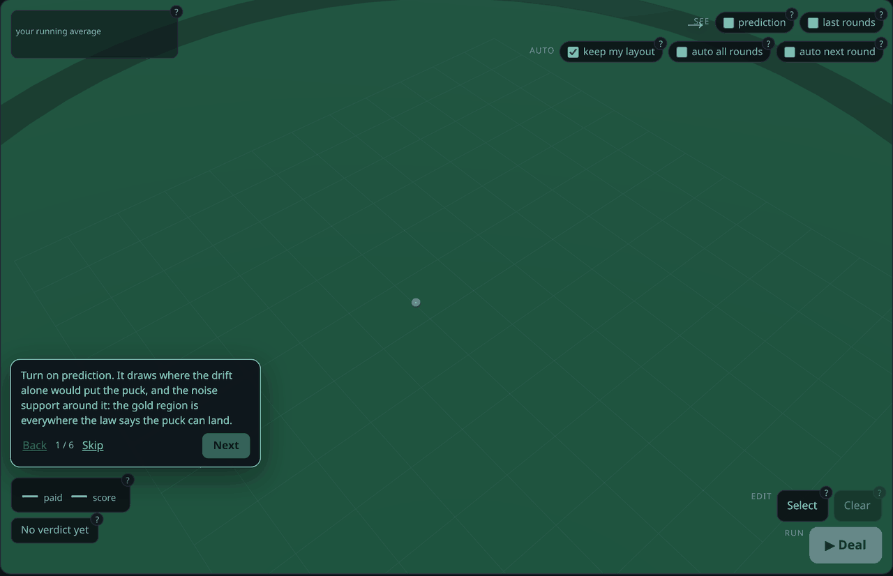
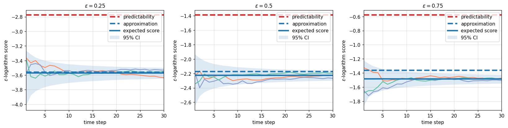

# ppsds: probabilistic prediction for stochastic dynamical systems

**How predictable is a system you only partly know?** `ppsds` answers from both sides: the
**ceiling** any prediction could reach on a system you know exactly, and a predictor that comes
with a **floor** over every system you are willing to admit.



**[Play it](understand_ppsds_by_pmf_betting/index.md)** — thirty seconds on that table explains
what this package is better than a paragraph can.

??? note "What you are looking at, and how it maps onto the package"

    A puck moves around a table. You put stacks where you think it will land next, the dealer drops
    a ball, and every stack within `epsilon` of the landing pays its share of your bet. That is the
    whole idea with the abstraction removed — the three things on screen are the three things the
    package is made of:

    | on screen | in the package |
    |---|---|
    | the moving puck | the **system** — a drift plus a known noise law |
    | the stacks you place | the **probabilistic predictor** — a pmf over where the puck will be |
    | how they pay | the **scoring rule** — the `epsilon`-logarithm score |

    Playing it is free, needs no install, and keeps nothing: the page has no server behind it.
    When you want the same thing done rigorously, the bets you place there export to a file the
    examples read back — that is the second half of
    [that story](understand_ppsds_by_pmf_betting/index.md).

## Install

```
pip install ppsds
```

Core dependencies are `numpy`, `scipy`, `cvxpy` and `gymnasium`; Python 3.10 or newer. Only the
experiment and plotting periphery needs more:

```
pip install "ppsds[experiments]"     # adds matplotlib, pandas, seaborn, tqdm
```

## Where do you want to start?

| …just play with it | …put it on a system of mine | …check it against the papers |
|---|---|---|
|  |  |  |
| Nothing to install. It is a static page, and it is the fastest way to see what a probabilistic prediction *is*. | You have a simulator or a Gymnasium environment and want a forecast that stays honest when your model drifts. **This is the main path.** | Read the papers, reproduce their figures, or build a predictor of your own kind. |
| **[Play it →](understand_ppsds_by_pmf_betting/index.md)** | **[Put it on your system →](getting-started.md)** | **[Concepts →](concepts.md)** |

## The examples

Four stories, each self-contained. Every one prints the numbers it talks about.

| Story | For | What it is |
|---|---|---|
| `understand_ppsds_by_pmf_betting` | anyone | The game above, then the same move over thousands of trajectories, measured against the ceiling no bettor can beat |
| `apply_drpp_to_your_own_env` | you have an environment | Four steps to put the predictor on your own system, then the two ways it goes wrong — including why *"my model is bad"* is **not** by itself a reason it wins |
| `understand_drpp_on_simulated_ambiguity` | you want the semantics | Declare an ambiguity set by hand, grow a system out of it, and watch three predictors face two meanings of "worst" |
| `understand_predictability` | you want the ceiling | The best any prediction could do on a *known* system, and the paper's figure |

[Examples](examples.md) has the command and the real output for each of them, and
[the map](map.md) shows how they connect.

## What "distributionally robust" changes

The objective, in one line: instead of trusting the nominal model, maximize the worst case over
the set.

```
    max over the predictive distribution p̂   of   min over P in the ambiguity set   of   E_P[ score(p̂) ]
```

The price is a little average performance: a more conservative predictive covariance. What it
buys is a floor that holds for every system in the set. The part that surprises people — **a
predictor does not become better by having a worse model**, and the declaration matters more than
the model's accuracy — is what [Concepts](concepts.md) is about.

## Two ways to use it

- **You already have a gymnasium environment.** Declare a nominal model and an ambiguity set, and
  let a predictor run. This is the main path, and it does not require the environment layer at
  all.
- **You want to simulate your own ambiguity**, to build a benchmark or to reproduce a paper.
  Then you also use the environment layer, which supplies the ambiguity set and a choice of
  dynamics modes, including an adversarial one.

[Getting Started](getting-started.md) covers the first; [Concepts](concepts.md) and
[Examples](examples.md) cover both.

## Where to go next

- **Thirty seconds, no install**: [play the betting game](understand_ppsds_by_pmf_betting/index.md)
- **You have an environment**: [Getting Started](getting-started.md) puts a predictor on it
- **You want the theory**: [Concepts](concepts.md), then
  [Predictability](predictability.md) for the other side of the same question
- **You want to extend it**: [Developer Guide](extending.md) — a new family of ambiguity sets,
  end to end
