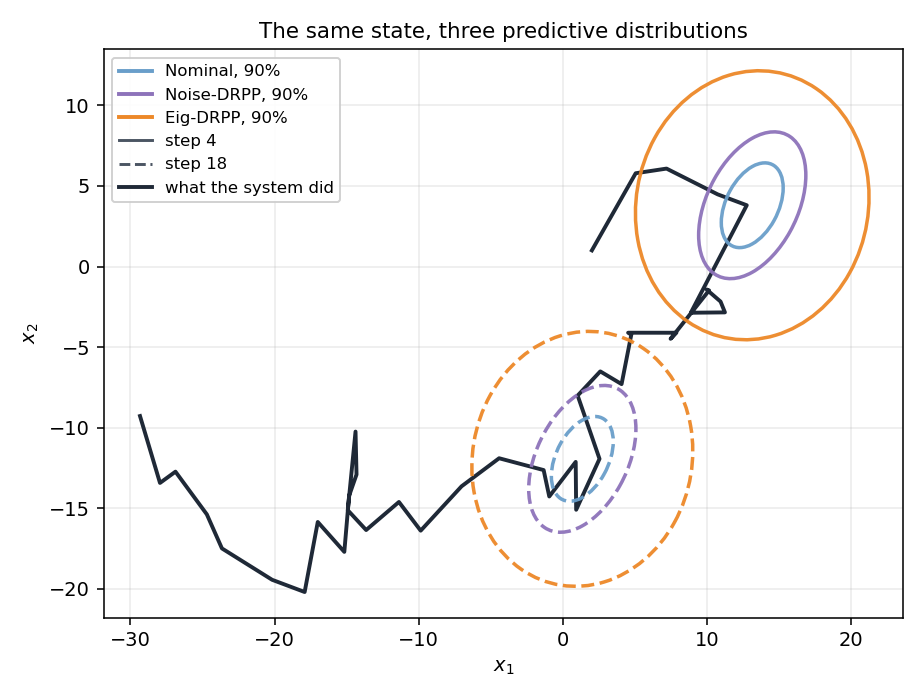
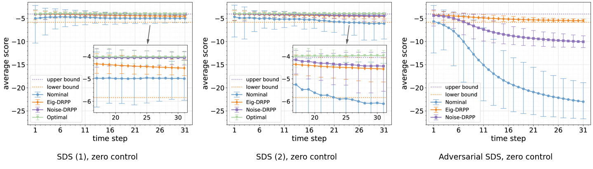

# Conic DRPP paper

*Distributionally Robust Probabilistic Prediction for Stochastic Dynamical Systems* asks what a
probabilistic predictor can promise when the model it was given is only approximately right. The
answer is a **floor**: a predictor whose worst-case expected score over a declared set of systems is
as high as it can be.

## The question

A probabilistic predictor returns a distribution for the next state. An ordinary one trusts its
nominal model. That works until the real system drifts away from it, and then the prediction is
quietly too narrow — **overconfident** exactly when honesty matters most. The paper's starting
point is that the nominal model can be wrong in two places at once: the state-evolution function and
the noise distribution.

## The maximin objective

The paper generalises the ambiguity set of distributionally robust optimisation to describe both
uncertainties, and optimises the expected score against the worst system in that set:

$$
\max_{\hat p}\ \min_{P \in \mathcal{P}}\
  \mathbb{E}_P\!\left[\log \hat p(x_{k+1} \mid x_k, u_k)\right]
$$

Read it inside out. The inner minimisation is an adversary that picks a system out of the set you
declared. The outer maximisation is your predictor, which may be designed knowing the set but not
which member will be chosen. The quantity scored is the logarithmic score of the predictive density
at the state that actually occurs.

What that looks like at one state: the three predictors the package ships, drawn as 90% ellipses
around the *same* point of the same trajectory. **Nominal** trusts the declared model, so its
ellipse is the declared covariance. **Noise-DRPP** widens it for the noise alone. **Eig-DRPP**
widens it further, for the drift as well — that extra area is the floor being paid for.



## The conic-moment family: three radii

The family implemented here constrains the **first two moments** of the noise, plus the norm of
the drift error, through a small number of scalars called `gamma`. Each one answers a different
question about how wrong you are willing to be.

| quantity | where it lives | what it bounds | squared? |
|---|---|---|---|
| drift radius | `gamma[0]`, the callable behind `f_err(x, u)` | the **squared norm** of the drift error: $\lVert\delta_f\rVert^2 \le \texttt{f\_err}(x,u)$ | **squared** |
| drift cap | `f_err_max` | the norm of the drift error itself: $\lVert\delta_f\rVert \le \texttt{f\_err\_max}$ | **un-squared** |
| noise-mean radius | `gamma[1]`, set by `alphas['mu']` | the **squared norm** of the noise-mean deviation: $\lVert\mu-\bar\mu\rVert^2 \le \gamma_1$ | **squared** |
| covariance scale | `gamma[2]`, set by `alphas['Sigma']` | the true noise covariance stays dominated by $\gamma_2 \bar\Sigma$ | neither; a scale factor |

> **Which are squared is the easiest thing to get wrong**, because the conventions here are not
> uniform, and they are deliberate. `f_err_max` is **un-squared**: it is a hard cap on the drift
> norm, and it doubles as the ball radius the sampler draws from, so it has to be a norm.
> `f_err(x, u)` and `gamma[1]` are **squared**: they are radii inside the cone program, which
> works with squared norms. In the linear parameterization the matrix perturbations
> `alphas['A']` and `alphas['B']` are also **un-squared**: they are the largest perturbation of
> an entry, so the sampler draws uniformly on `[-alphas['A'], alphas['A']]`.

Physically, the three numbers are three independent ways for your belief to be wrong:

- **Drift radius (`gamma[0]`).** How far the true drift may sit from the nominal drift, measured
  as a norm. It is a function of the state and control rather than a constant, because the size
  of a drift error is proportional to how far the system has moved and how hard you are pushing
  it. It enters the predictive **mean only**.
- **Noise-mean radius (`gamma[1]`).** How far the true noise mean may sit from the nominal one.
  It enters **both** the predictive mean and the covariance.
- **Covariance scale (`gamma[2]`).** How much larger the true noise covariance may be than the
  nominal one. It enters the predictive **covariance only**.

One identity is worth memorizing:

> **The predictive covariance is the noise covariance.**

The prediction's spread is not modeled separately: it *is* the noise covariance of your belief.
So "how wrong can the noise be" directly determines how wide the prediction has to be, and the
covariance scale `gamma[2]` sets that width. The adversary's freedom on the noise is the
prediction's width; the adversary's freedom on the drift is a shift of the mean.

Concretely, the worst case is built by selecting **one** worst eigen-direction `j` of the nominal
covariance, then shifting the predictive mean along it and reshaping the covariance around the
same axis. The mean shift combines the drift and noise-mean radii along that direction, and the
covariance is scaled by `gamma[2]` while being tightened along the chosen axis. One direction,
chosen to hurt most, not a wholesale inflation of the uncertainty.

One clarification that is easy to misread: **the ambiguity set does not assume the noise is
Gaussian.** It constrains moments. Gaussianity appears only downstream, in the kernel used to
sample noise and in the logarithmic scoring rule. "Moment constraints" is not shorthand for
"distributional assumptions".

## Calibration, not model accuracy

`NominalPredictor` is the baseline that does no robustification at all. Its predictive mean comes
from the nominal drift and the nominal noise mean, and its predictive covariance is exactly
`Sigma_bar`. Against a system that behaves as expected, that is the right answer.

It is tempting to read DRPP as "for when your model is bad". That is not the mechanism, and
getting this wrong leads people to declare radii for the wrong reason. The point is
**calibration**, not model accuracy:

> The score is decided by whether the predictive spread matches the spread of the error that
> actually occurs, not by how small that error is.

If `Sigma_bar` was estimated from the residuals of the very system you are predicting, then it
already reflects however wrong your model is. A structurally wrong model with a covariance fitted
to its own residuals is still well calibrated: its errors are large, and its declared spread is
large to match. Robustifying means widening the prediction, and a wider density scores worse
when it was already the right width. So when the declaration is accurate, robustification is
pure cost, and the nominal predictor wins.

DRPP pays off in the **other** regime: when the declaration is **optimistic** and the declared
spread is narrower than the errors that actually occur. The most common reason is **too little
identification data**: a covariance estimated from a handful of residuals is itself biased low.
There the robust covariance is not a premium being paid; it is covering an error the nominal
covariance already had.

## From function space to Euclidean space

The exact problem is hard: it optimises over probability measures with densities, and the outer step
is a nonconvex semidefinite program whose global optimum is NP-hard. The paper's methodology has
two moves:

1. dynamic programming gives a Bellman equation for the maximin;
2. a necessary optimality condition transforms the problem from function spaces into **Euclidean**
   spaces, where the per-step problem can actually be solved.

## Two suboptimal predictors

Two relaxations make the problem tractable, and each defines a predictor the package ships:

| Predictor | Relaxation | What it is robust to |
|---|---|---|
| `NoiseDrpp` | relax the constraints on the ambiguity set to noise only | the noise; the drift radius is ignored |
| `EigDrpp` | fix the predictive covariance's **eigenvectors** to those of `Sigma_bar`; optimise only the eigenvalues | both, within the fixed-eigenvector restriction |

With the eigenvectors pinned, the functional maximin collapses into a **Euclidean cone program**,
solved per step by `eigvec_fixed_minmax` using CVXPY. The paper also derives an upper bound on the
optimality gap between these predictors and the global optimum.

`EigDrpp` gives up **optimality, not the guarantee**: it returns a lower bound on the achievable
worst-case value, and that bound still holds for every system in the set.

## What `EigDrpp` gives up

The exact DRPP is **hard**. The outer step, choosing the predictive covariance that maximizes
the worst-case score, is a nonconvex semidefinite program whose global optimum is NP-hard, and a
single-step DRPP is equivalent to finding a global minimax point, which is NP-hard even in very
simple settings. Something has to be relaxed.

The relaxation is a restriction of the predictor to a **smaller family**. The eigenvectors of the
predictive covariance are **fixed** to those of the nominal covariance `Sigma_bar`, and only the
**eigenvalues** are optimized:

$$
\operatorname{eigvec}(\Sigma_{\mathrm{pred}}) := \operatorname{eigvec}(\Sigma_{\mathrm{bar}})
\quad\text{(fixed)},\qquad
\operatorname{eigval}(\Sigma_{\mathrm{pred}}) \ \text{optimized each step.}
$$

With the eigenvectors pinned, the functional maximin collapses into a **Euclidean cone program**,
solved per step by `eigvec_fixed_minmax` using CVXPY. That collapse is the whole reason the
problem becomes tractable: without fixing the basis there is no cone program to write down.

What it gives up is **optimality, not the guarantee**. `EigDrpp` returns a **lower bound** on the
achievable worst-case value. The bound still holds for every system in the set, but its value may
sit below the true optimum, because the predictor was not allowed to rotate its covariance. In one
line: *Eig-DRPP is not a weaker guarantee; it is the same guarantee at a more conservative value.*

The package's three predictors are points along this spectrum:

| predictor | predictive covariance | what it is robust to |
|---|---|---|
| `NominalPredictor` | `Sigma_bar` | nothing; it trusts the nominal model |
| `NoiseDrpp` | `gamma[2] * Sigma_bar` | the noise only; the drift radius is ignored |
| `EigDrpp` | solved per step | both, within the fixed-eigenvector relaxation |

### Two bounds bracket the answer

Two quantities in the ambiguity set frame the achievable score from either side, and comparing
them is the clearest way to see what the relaxation costs:

- `value_upper_bound_true_transition()`: the score achievable when the **true transition is
  known**. No predictor can beat this, so it is an upper bound on what any predictor can score
  inside that set.
- `value_lower_bound_eigvec_fixed()`: the score `EigDrpp` **guarantees** under the fixed-eigenvector
  relaxation. It is computed *by* that minmax, which is why the ambiguity set depends on the
  predictor: the lower bound has no meaning without it.

The gap between them is the price of making the problem solvable. This pair is **inside one
declared set**; it is not the pair that compares predictability with DRPP, which is on
[Preliminaries](preliminaries.md#two-pairs-of-bounds).

## The experiments

The paper's numerical study covers linear and nonlinear systems, two meanings of “worst”, and two
control regimes. On this site:

- **The semantics, taught in one script**: [what “worst case” means](../examples/understand_drpp_on_simulated_ambiguity/index.md)
- **The paper-scale runner**: [the DRPP experiment](../experiments/drpp.md) — seven models, a
  validated cache, the error-bar and ellipse figures
- **The bounds, and what the relaxation costs**: [what the relaxation costs](#what-eigdrpp-gives-up)

The figure below is the paper's zero-control comparison, reproduced from the paper's own vector
figures:



## What `ppsds` implements

| Paper object | In the package |
|---|---|
| conic-moment ambiguity set | `ppsds.ambiguity.additive_drift.conic_moment.LinearAmbiguitySet` / `NonlinearAmbiguitySet` |
| Noise-DRPP | `ppsds.probabilistic_predictor.drpp.additive_drift.conic_moment.NoiseDrpp` |
| Eig-DRPP | `...EigDrpp` |
| the fixed-eigenvector minmax | `eigvec_fixed_minmax` |
| the adversarial environment mode | `ppsds.environment.dynamics_mode.EigvecFixedAdversarialDynamics` |
| the batch experiments | [`experiments/drpp/`](https://github.com/Xuzerken/ppsds/tree/main/experiments/drpp) |

The guarantee is **conditional on the declaration**: it holds for every system in the set you
wrote down, and says nothing about a system outside it. The library cannot check that condition for
you. [Preliminaries](preliminaries.md#honest-limits) state the limits in full.

## Next

- **The common vocabulary**: [Preliminaries](preliminaries.md)
- **The other paper**: [probabilistic predictability](probabilistic-predictability.md)
- **Put it on a system of your own**: [Getting Started](../tutorials/getting-started.md)
- **Add a family of your own**: [A new family and its DRPP](../tutorials/developer-guide.md)

## Citation

```bibtex
@article{xuDRPP,
  title   = {Distributionally Robust Probabilistic Prediction for Stochastic Dynamical Systems},
  author  = {Xu, Tao and He, Jianping},
  journal = {IEEE Transactions on Automatic Control},
  volume  = {71},
  number  = {10},
  pages   = {6385--6400},
  year    = {2026},
  doi     = {10.1109/TAC.2026.3687495}
}
```

The software itself has a separate entry in the
[repository's `CITATION.cff`](https://github.com/Xuzerken/ppsds/blob/main/CITATION.cff).
