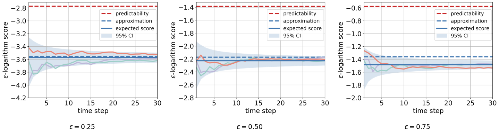

# Probabilistic predictability paper

DRPP answers *"what can a predictor guarantee when the model is uncertain?"* — a **lower** bound.
This page is the other side: *"how well could anything predict this system, if the system were
known exactly?"* — an **upper** bound. Together they bracket what prediction can do, and the gap
between them is what your model uncertainty is costing you.

## The question the paper asks

A probabilistic predictor is judged by a scoring rule. The celebrated logarithm score is proper,
but it is fragile for multimodal or sparse predictions: a pdf being large at one point does not
mean much probability sits around it, and a pmf with finite support scores `-inf` almost everywhere.
The paper asks what happens if the score looks at a **neighbourhood** of radius `epsilon` instead of
a point, and what that implies for how predictable a system is at all.

## The three results

1. **An `epsilon`-logarithm score** that generalises the logarithm score and is finite for sparse
   predictions. It reduces to the logarithm score at `epsilon = 0` — discontinuously, as explained
   below.
2. **A closed-form predictability bound**, `d log(2 epsilon) - h_d(q)`: the best expected score any
   predictor could achieve on a system known exactly, determined by the radius, the differential
   entropy of the process noise, and the state dimension. No predictor is involved in computing it.
3. **An `O(epsilon)` approximation** for the expected score of any given predictor, plus a
   single-trajectory result: under i.i.d. process noise the time-averaged score converges to the
   expectation, at rate $O(T^{-1/2})$ in probability.

The figure below is the paper's own, across three radii. The site reproduces it from code:



- **The example**: [six golden values you can check by hand](../examples/understand_predictability/index.md)
- **The experiment**: [the same figure over 100,000 trajectories](../experiments/predictability.md)
- **The other paper**: [conic-moment DRPP](drpp-conic.md)

## A score that looks at a neighbourhood

The ordinary logarithm score evaluates a predictive distribution at the exact outcome:

$$
L(p, x) = \log p(x)
$$

That one number is fragile in a specific way: it is `-inf` the moment the outcome lands anywhere
your prediction put zero probability, and for a prediction with *sparse* support — a pmf with a
handful of atoms — that is almost every outcome. The `epsilon`-logarithm score replaces the point
with a neighbourhood:

$$
L_\epsilon(\hat p, x)
  = \log \int_{\{\,s \,:\, \lVert s - x \rVert_\infty \le \epsilon\,\}} \hat p(s)\,\mathrm{d}s
$$

The score is now the log of the probability **near** what happened, which is finite for a sparse
prediction and reduces to the ordinary logarithm score when `eps = 0`.

> **The score is discontinuous at `eps = 0`.** At exactly zero it is `log p(x)`; for any
> `eps > 0` the neighbourhood integral is roughly `(2 eps)^d * p(x)`, so the score carries a
> `d * log(2 eps)` penalty and runs to `-inf` as `eps` shrinks. The ordinary logarithm score is
> recovered by *subtracting* that term, not by taking a limit. This is a property of the
> definition, not a numerical artefact.

## Predictability is an upper bound, and it needs no predictor

Maximise that score's expectation over *every* admissible predictive distribution and you get a
number that describes the **system**, not any method — the *probabilistic predictability*:

$$
\text{predictability} = d \log(2\epsilon) - h_d(q)
$$

where `d` is the state dimension and `h_d(q)` is the differential entropy of the true one-step
distribution. Nothing about a predictor appears: this is the best expected score achievable, full
stop.

For a **given** predictor `p`, the same theorem gives an approximation to its expected score, with
an error of order `eps`:

$$
\mathbb{E}[L_\epsilon(\hat p, x)]
  = d \log(2\epsilon) - H(q \,\|\, \hat p) + O(\epsilon)
$$

That is the line a continuous predictor's measured score converges to. It does **not** exist for a
pmf predictor: an atom law has no density, so `H(q || p)` is infinite and there is nothing to
plot. For those, the upper bound is the only reference there is.

```python
from ppsds.numerics.random_variables import multivariate_uniform
from ppsds.predictability.bounds import approximation_value, predictability_upper_bound
from ppsds.predictability.entropy import cross_entropy, differential_entropy
from scipy.stats import multivariate_normal

noise = multivariate_uniform(low=-np.ones(2), high=np.ones(2))     # the true process noise
predictor = multivariate_normal(mean=np.zeros(2), cov=np.eye(2))   # some predictor's law

predictability_upper_bound(noise, eps=0.5)          # the best anyone could do
approximation_value(noise, predictor, eps=0.5)      # where this predictor should land
```

> This package does **not** ship a predictor that attains the upper bound. The bound is here to be
> *measured against* — it tells you how much room is left, and it is the honest reference line for
> any predictor you bring, including one you wrote yourself.

## One trajectory is enough

The expectation above is over trajectories, and averaging over many of them is the obvious way to
estimate it. It is also unnecessary. For a system whose process noise is i.i.d., the score on a
**single** trajectory, averaged over its own steps, converges to the expected score — at rate
`O(T ** -0.5)` in probability:

```python
from ppsds.predictability.trajectory import across_trajectories, cumulative_average

# scores is (n_traj, T): one epsilon-logarithm score per step per trajectory
running = cumulative_average(scores)          # each row becomes its own running average
band = across_trajectories(running)           # mean and 2.5% / 97.5% across trajectories
```

So a handful of curves is a legitimate estimate, and a single long rollout is a legitimate
measurement. That is why the figures for this need no repeated sampling — and why the score you
watch accumulate step by step is not a noisy stand-in for the real number, it *is* the real number
converging.

## Evaluating your own predictor

Any predictive law works, as long as it can integrate over a box:

| what you have | what to provide |
|---|---|
| a `scipy.stats` distribution | nothing — the score integrates through its CDF |
| a **diagonal** Gaussian | nothing — a closed form is used, which is what makes large sweeps cheap |
| a pmf / atom law | the law object, e.g. `ppsds.numerics.atom_pmf.AtomPmf` |
| anything else | a `box_integral(x, eps)` method returning the probability inside the box |

```python
from ppsds.scoring_rule.epsilon_logarithm_score import EpsilonLogarithmScore

scorer = EpsilonLogarithmScore(eps=0.5)
scorer(my_predictive_law, x)            # one outcome
scorer(my_predictive_law, outcomes)     # or a batch, shape (n, d)
```

A predictor that puts no probability within `eps` of what happened scores `-inf`. That is the
correct settlement, not an error.

## Where this sits relative to DRPP

- **Predictability** — the best expected score for a system known **exactly**. An upper bound, and
  a property of the system.
- **DRPP** — the score a predictor can **guarantee** for a system known only through an ambiguity
  set. A lower bound, and a property of the predictor.

They are not the same pair as `value_upper_bound_true_transition()` /
`value_lower_bound_eigvec_fixed()`, which bracket the relaxation gap **inside one** ambiguity set.
See [Preliminaries](preliminaries.md) for how the two pairs fit together.

## Next

- **Feel the ceiling**: [the betting game](../examples/understand_ppsds_by_pmf_betting/index.md)
  measures its bets against exactly this number
- **Check the numbers by hand**: [the predictability example](../examples/understand_predictability/index.md)
  prints the golden values
- **Reproduce the figure**: [the predictability experiment](../experiments/predictability.md)
- **The other bound**: [conic-moment DRPP](drpp-conic.md) — what a predictor can guarantee when the
  system is *not* known exactly
- **Score your own predictor against it**: [API reference](../api.md) for
  `predictability_upper_bound` and `approximation_value`

## Citation

```bibtex
@article{xuProbabilisticPredictability,
  title   = {Probabilistic Predictability of Stochastic Dynamical Systems},
  author  = {Xu, Tao and Li, Yushan and He, Jianping},
  journal = {Automatica},
  volume  = {174},
  number  = {112160},
  year    = {2025},
  doi     = {10.1016/j.automatica.2025.112160}
}
```
