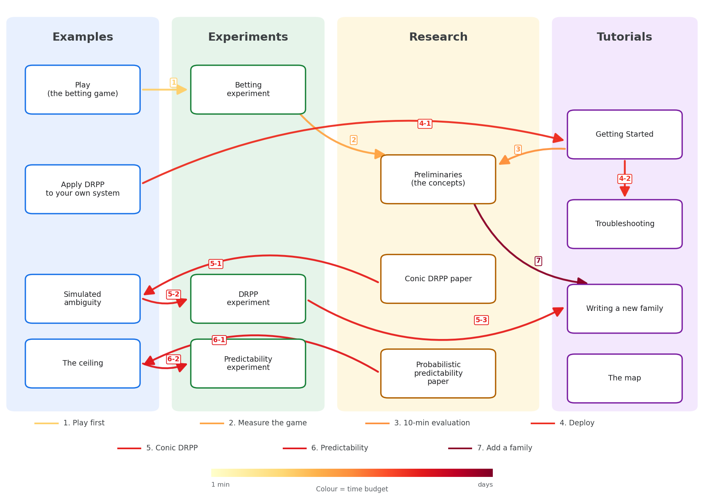

# The map

The sidebar is the shelf order — one reasonable route through the material, arranged so that each
page makes sense after the one above it. This page is the graph instead, for reading in whatever
order your own question suggests.



## The routes, in words

| # | Route | For | Path |
|---|---|---|---|
| 1 | **Play first** | Anyone, no prerequisites | [the betting game](../examples/understand_ppsds_by_pmf_betting/index.md) → [the betting experiment](../experiments/pmf_betting.md) → [Preliminaries](../research/preliminaries.md) |
| 2 | **Measure the game properly** | You played the game and want the numbers | [the betting game](../examples/understand_ppsds_by_pmf_betting/index.md) → [the betting experiment](../experiments/pmf_betting.md) → [Preliminaries](../research/preliminaries.md) |
| 3 | **The 10-minute evaluation** | You are deciding whether to try it | [apply quickstart](https://github.com/Xuzerken/ppsds/blob/main/examples/apply_drpp_to_your_own_env/quickstart.py) → [the honest limits](../research/preliminaries.md#honest-limits) |
| 4 | **Deploy on your own system** | You have a Gymnasium environment | [Getting Started](getting-started.md) → [apply DRPP to your own environment](../examples/apply_drpp_to_your_own_env/index.md) → [Troubleshooting](troubleshooting.md) |
| 5 | **Check or reproduce the conic DRPP paper** | You read the DRPP paper | [the paper](../research/drpp-conic.md) → [simulated ambiguity](../examples/understand_drpp_on_simulated_ambiguity/index.md) → [the DRPP experiment](../experiments/drpp.md) → [A new family and its DRPP](developer-guide.md) |
| 6 | **Check or reproduce the probabilistic predictability paper** | You read the predictability paper | [the paper](../research/probabilistic-predictability.md) → [the ceiling](../examples/understand_predictability/index.md) → [the predictability experiment](../experiments/predictability.md) |
| 7 | **Do research, or add a family** | You want to change `ppsds` | [Preliminaries](../research/preliminaries.md) → either paper → [A new family and its DRPP](developer-guide.md) → [CONTRIBUTING](https://github.com/Xuzerken/ppsds/blob/main/CONTRIBUTING.md) |
The number on each route in the map matches this table. **Colour is the time budget**: blue for
minutes, red for days (the strip under the map).

Two shorter routes cross the same graph:

- **You have an environment and want to get on with it.** Skip straight to
  [Getting Started](getting-started.md) — the apply example is what you read when the four-step
  declaration needs justifying.
- **You have read one of the papers.** Two entries, depending on which:
  [probabilistic predictability](../research/probabilistic-predictability.md) for the probabilistic
  predictability paper on the ceiling, and [conic DRPP](../research/drpp-conic.md) for the conic DRPP paper on
  the floor. Both meet the [Developer Guide](developer-guide.md).

## Which part of the package does what

The examples use the same handful of subpackages in different combinations. This is the whole
public surface, one line each.

| Subpackage | It answers | You meet it in |
|---|---|---|
| `ppsds.ambiguity` | *What am I willing to admit about the system?* — the belief, written as a set | every example that names a DRPP |
| `ppsds.probabilistic_predictor` | *A prediction is a distribution, not a point.* Kinds sit side by side: `drpp/` derives one from an ambiguity set, `pmf/` takes one you supply | all four examples |
| `ppsds.scoring_rule` | *How well did it do?* — one number. The `epsilon`-neighbourhood score is what lets a **pmf** be scored at all | all four |
| `ppsds.predictability` | *How well could anything have done?* — the ceiling, which needs no predictor | the predictability example and experiment, and the betting experiment |
| `ppsds.dynamics` | *The system itself* — known dynamics, mechanical models, and identifying a nominal model from rollouts | the two examples that use a real environment |
| `ppsds.environment` | *Run it as an environment* — for a system you declared an ambiguity set for | the simulated-ambiguity example and the DRPP experiment |
| `ppsds.numerics` | Small numerical tools, and the weighted-atom pmf | the betting game |
| `ppsds.experiment`, `ppsds.visualization` | Running many runs reproducibly, and drawing the result (extra `pip install "ppsds[experiments]"`) | the experiments |

## The one structural fact worth carrying away

```text
   ambiguity/                     additive_drift/conic_moment.py
   probabilistic_predictor/drpp/  additive_drift/conic_moment.py
   environment/dynamics_mode/adversarial/
                                  additive_drift/conic_moment.py
   experiment/drpp/               additive_drift/conic_moment.py
```

**Each family of ambiguity sets yields its own DRPP**, so a new family is a new module at the same
level in all four places — not a new branch inside the existing files. The path states the scope
layer by layer: *assumption* (additive drift) then *family* (conic moment). That is what
[the Developer Guide](developer-guide.md) walks through.

## Next

- **Start at the front door**: [play the betting game](../examples/understand_ppsds_by_pmf_betting/index.md)
- **Or skip to your case**: [Getting Started](getting-started.md) if you have an environment
- **The full list of stories**: [Examples](../examples/index.md)
- **What the guarantee costs**: [Research](../research/index.md)
